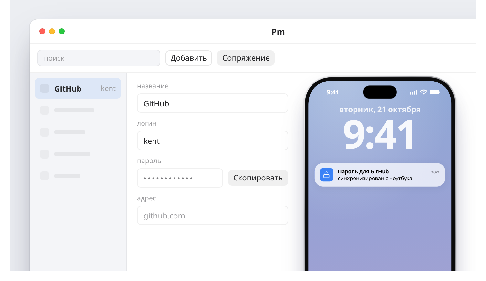
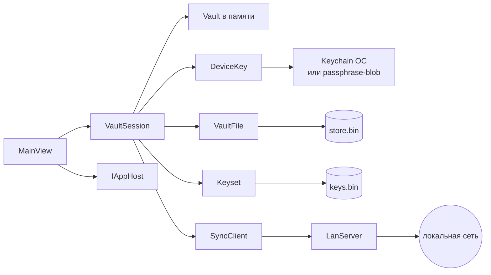
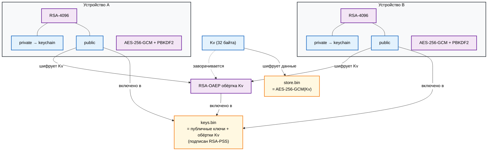

# Pm

Менеджер паролей для одной локальной сети. Пароль, сохранённый на ноутбуке,
появляется на телефоне при следующей синхронизации. Наружу не уходит ничего -
ни облака, ни аккаунта, ни подписки. Сервер не видит паролей: по сети ходят
только шифротекст и публичные ключи.

Пароль устройства больше не спрашивается: ключ лежит в ключнице системы
(GNOME Keyring, Windows DPAPI, iOS Keychain). Приложение открывается сразу.

## Превью



Иллюстрация показывает раскладку интерфейса. В самом приложении та же
раскладка, светлая или тёмная тема - по системе или в настройках, и родная
рамка окна.

## Сборка

```sh
bash scripts/build-linux.sh ~/Downloads     # ~/Downloads/Pm-x86_64.AppImage
bash scripts/build-windows.sh ~/Downloads   # ~/Downloads/Pm.exe
```

- `Pm-x86_64.AppImage` - один файл для окна и CLI: без аргументов открывает
  приложение, с командой работает как `pm`. На Ubuntu 24.04 может понадобиться
  `libfuse2t64`.
- `Pm.exe` - то же для Windows: self-contained, single-file. Двойной клик
  открывает окно и прячет консоль; запуск из `cmd` или PowerShell с командой
  работает как обычный CLI.
- `.ipa` для iPhone собирается отдельно.

## Использование

### Первый запуск

Приложение показывает приветствие на языке системы, создаёт ключ и хранилище
и проводит короткий тур со стрелками: «Добавить» → «Сопряжение» → статус
синхронизации. Тур показывается один раз; повторить - кнопкой «?».

По умолчанию пароля нет: ключ устройства хранится в ключнице ОС и привязан к
вашей учётной записи. Если ключницы нет, приложение честно пишет, что ключ
лежит в файле `0600`, и работает дальше.

В настройках можно установить passphrase от 4 до 30 символов. Тогда ключ
хранится в keychain зашифрованным, спрашивается при запуске и после блокировки.
Новый защищённый ключ проверяется сразу после записи; если ключница его не
сохранила, старый ключ не удаляется. Восстановления passphrase нет: забыли
пароль - потеряли доступ. Если установка passphrase когда-то не завершилась и
старый ключ остался в ключнице, `pm keychain-status` это покажет, а
`pm recover` снимет passphrase.

### Интерфейс

- `Ctrl +` / `Ctrl −` - увеличить или уменьшить масштаб, `Ctrl 0` - сброс.
- `⚙` - язык (системный, русский, English), тема (системная, светлая, тёмная),
  список устройств и защита паролем. Настройки хранятся в `ui.json` на этом
  устройстве.
- В настройках видно локальное и сопряжённые устройства: отпечатки, адреса и
  кнопка «Отозвать». Отзыв меняет ключ хранилища; остальные устройства получат
  его при следующей синхронизации.
- Смена языка применяется сразу, без перезапуска.
- При установленном пароле в тулбаре появляется «Заблокировать».
- С passphrase приложение блокируется после 5 минут бездействия и при выходе
  из сна или возврате из фона; для разблокировки снова нужна passphrase.

### Записи

- «Добавить» - новая запись: название, логин, пароль, адрес, заметки.
- После сохранения сразу открывается бланк следующей записи. Для правки
  выберите запись в списке.
- ПКМ по записи или `⋯` - «Редактировать» / «Удалить».
- «Сгенерировать» - случайный пароль.
- «Копировать» - пароль в буфер; через 30 секунд Pm очищает буфер, если там
  всё ещё лежит этот пароль.

### Сопряжение двух устройств

Всё внутри приложения, консоль не нужна:

1. На компьютере: «Сопряжение» → «Показать адрес и код».
2. На втором устройстве: «Сопряжение» → «Найти устройства» → выбрать
   компьютер в списке (UDP-обнаружение в локальной сети).
3. Ввести 6 цифр с экрана компьютера.
4. На втором устройстве сверьте отпечаток компьютера и нажмите «Совпадают».
5. На компьютере появится отпечаток второго устройства: сверьте его и нажмите
   «Совпадают». После этого пароли синхронизируются.

Если обнаружение не сработало (гостевая Wi-Fi, изоляция клиентов), адрес можно
ввести вручную - поле есть в том же окне.

iPhone не может показывать код: iOS не даёт приложению слушать порт в фоне.
Код всегда показывает компьютер, телефон его вводит.

### Синхронизация

- при открытии приложения;
- после каждого сохранения;
- раз в 30 секунд;
- кнопкой «Синхронизировать».

Пока оба приложения запущены, изменения доезжают за несколько секунд. Хаб не
нужен. Синхронизация идёт напрямую по локальной сети.

### CLI

CLI встроен в то же приложение. Без аргументов открывается окно, с командой
запускается командный режим:

```sh
# Linux
./Pm-x86_64.AppImage --help
./Pm-x86_64.AppImage add GitHub --login kent --generate

# Windows
Pm.exe --help
Pm.exe add GitHub --login kent --generate
```

Для разработки можно запускать CLI из исходников:

```sh
alias pm='dotnet run --project src/Pm.Desktop --'

pm init --label laptop
pm add GitHub --login kent --generate
pm ls
pm get github
pm open               # адрес, отпечаток и ID сопряжённых устройств
pm revoke ID          # отозвать устройство
pm keychain-status    # есть ли passphrase и старый ключ
pm recover            # снять passphrase, если остался старый ключ
pm pair-wait          # адрес и код
pm pair 192.168.1.10:47821 482913
pm serve
pm sync
```

CLI использует ту же ключницу, что и приложение. Если установлен passphrase,
CLI попросит его. Исключение - старое хранилище с `device.key`: первый запуск
один раз попросит старый пароль и перенесёт ключ в ключницу.

`pm pair` и `pm pair-wait` показывают отпечатки и спрашивают подтверждение;
для скриптов его пропускает `PM_CONFIRM=1`.

В SSH-сессии без доступа к шине ключница недоступна: запускайте CLI в
графической сессии того же пользователя.

## Как это работает

### Где что хранится

| Что | Где | Чем защищено |
|---|---|---|
| Пароли записей | `store.bin` | AES-256-GCM, ключ `Kv` |
| Ключ хранилища `Kv` | `keys.bin`, обёрнут RSA-OAEP | приватный ключ устройства |
| Приватный ключ устройства | keychain ОС; при passphrase - зашифрованный blob | ОС / passphrase (PBKDF2 + AES-GCM) |
| Публичные ключи и обёртки `Kv` | `keys.bin` | подпись RSA-PSS |
| Параметры устройства | `config.json` | секретов нет |
| Тема, язык, флаги | `ui.json` | секретов нет |
| Старый `device.key` | только для миграции | старый пароль; после миграции переименовывается |
| Скопированный пароль | буфер обмена ОС | очищается через 30 секунд |
| Расшифрованное хранилище | память процесса | пока приложение разблокировано |
| Сеть | HTTP в локальной сети | только шифротекст и публичные ключи |

Passphrase нигде не хранится: она расшифровывает приватный ключ устройства.
Поэтому потеря passphrase означает потерю доступа.

На Unix каталог `Pm` - `0700`, а `store.bin`, `keys.bin`, `config.json` и
файлы `.prev` - `0600`. Старые права исправляются при следующем открытии
хранилища.

### Схема приложения





- **Хранилище.** Записи лежат в `store.bin` под AES-256-GCM. Ключ `Kv` случайный.
- **Ключи.** `Kv` завернут RSA-OAEP под публичный ключ каждого сопряжённого
  устройства. Приватный ключ не покидает устройство.
- **Подпись.** Список устройств и обёрток (`keys.bin`) подписан RSA-PSS, поэтому
  чужое устройство нельзя дописать незаметно.
- **Ключница.** Приватный ключ в GNOME Keyring / DPAPI / iOS Keychain. По
  умолчанию пароля приложения нет: безопасность равна безопасности учётной
  записи в системе. Опционально ключ шифруется passphrase (PBKDF2 + AES-GCM)
  и без него не расшифровывается.
- **Сопряжение.** 6 цифр с HMAC подтверждают, что на другом конце живой человек.
  Отпечатки ключей оба пользователя сверяют до того, как сервер отдаст ключ
  хранилища.
- **Отзыв с любого устройства.** При синхронизации устройство отправляет свой
  `keys.bin` вместе с подписью; сервер принимает более новый список и
  перевыпускает ключ. Поэтому отзыв, сделанный на телефоне, доезжает до
  компьютера, а не только наоборот.
- **Обнаружение.** UDP-broadcast на порту 47830, только в локальной сети.
  Никаких внешних соединений.
- **Слияние.** У записи счётчик версий (Lamport). При параллельной правке
  побеждает детерминированный вариант, а проигравший сохраняется отдельной
  записью «(конфликт)». Ни один пароль не теряется.
- **Удаление.** Надгробия хранятся всегда, поэтому удалённая запись не
  возвращается с устройства, которое долго не выходило в сеть. Логин, пароль,
  адрес и заметки из надгробия стираются.
- **Транспорт.** HTTP по локальной сети: содержимое уже зашифровано и подписано
  на уровне устройств, поэтому TLS не нужен. Видны только факт соединения и
  размер файла.

Границы модулей, модель доверия, состояние на диске, правила синхронизации и
почему это модульный монолит, а не микросервисы:
[docs/architecture.md](docs/architecture.md).

## Проверка

```sh
dotnet run --project src/Pm.Desktop -- selfcheck
# или готовый бинарник
./Pm-x86_64.AppImage selfcheck
```

Проверяет AES-GCM и отказ при подмене, RSA-обёртку и подпись, слияние версий и
конфликтов, стирание секретов из надгробий, отказ при неверном пароле и битом
файле, passphrase и миграцию старого `device.key`, первый запуск с ключницей,
восстановление после рассинхрона `keys.bin` и `store.bin`, сопряжение по коду,
отзыв устройства с сервера и с клиента, отсутствие воскрешения отозванного
устройства из устаревшей ветки, обмен записями в обе стороны, запись из другого
процесса, отказ чужому формату протокола, отдельную ошибку рассинхрона часов и
отказ битому `store.bin` по сети.

Последний прогон: все проверки зелёные. Ключница проверена вручную.

## Состав

| Путь | Что внутри |
|---|---|
| `src/Pm.Core` | модели, AES-GCM, RSA, `keys.bin`, слияние, открытие хранилища |
| `src/Pm.Sync` | клиент синхронизации, сопряжение, UDP-обнаружение, порт `IAppHost` |
| `src/Pm.Net` | HTTP-узел для приёма синхронизации |
| `src/Pm.Secrets` | GNOME Keyring, Windows DPAPI, файловый резерв |
| `src/Pm.App` | общий UI: приветствие, тур, список, карточка, устройства, сопряжение |
| `src/Pm.Desktop` | окно десктопа, сервер и CLI-режим |
| `src/Pm.App.iOS` | экран iPhone и Keychain |
| `src/Pm.Cli` | команды `pm` и `selfcheck` для приложения и разработки |
| `scripts/` | сборка AppImage и exe (GUI + CLI) |
| `.github/workflows/release.yml` | Linux, Windows и iOS на тег `v*` |
| `assets/`, `docs/` | иконка, иллюстрация и архитектурная заметка |

## iOS и AltStore

`.ipa` собирается в GitHub Actions на macOS-раннере; на тег `v*` он попадает в
релиз вместе с AppImage и exe. Для бесплатных macOS-минут репозиторий должен
быть публичным.

AltStore подписывает `.ipa` вашим Apple ID: бесплатный аккаунт - установка на
7 дней и переподпись раз в неделю, платный $99 - на год. Сертификат отдельно
покупать не нужно.

## Ограничения

- **iOS не проверен на устройстве.** Проект и CI написаны здесь, но собрать и
  запустить iOS на Linux невозможно. Первый прогон macOS-джобы может
  потребовать правок в подписи и упаковке `.ipa`.
- **Windows-сборка** `.exe` собран кросс-компиляцией и не
  подписан: Windows покажет предупреждение SmartScreen.
- **Одна версия протокола на обоих устройствах.** Сопряжение и синхронизация
  проверяют формат и отказывают при расхождении. Новый протокол подтверждает
  отпечатки на обоих экранах до обмена ключом; устройство со старой версией
  нужно обновить.
- **Синхронизация только при запущенных приложениях.** iPhone не принимает
  соединения в фоне.
- **Обнаружение - UDP-broadcast.** Работает в пределах одной подсети; при
  изоляции клиентов остаётся ручной ввод адреса.
- **Нет автозаполнения.** Пароль копируется кнопкой. Расширение браузера и
  iOS AutoFill - следующий этап.
- **Нет импорта, экспорта, TOTP, папок и тегов.**
- **Нет восстановления passphrase.** Забыли пароль - доступа нет.
- **Отзыв устройства.** `pm revoke ID` убирает устройство из `keys.bin`, меняет
  ключ хранилища и перевыпускает обёртки для оставшихся устройств. Новый
  `keys.bin` уходит при следующей синхронизации - с сервера или с самого
  клиента. Всё, что отозванное устройство уже скачало, остаётся читаемым:
  старую копию отозвать нельзя.
- **Без passphrase.** Любой процесс под вашей учётной записью может прочитать
  хранилище. Passphrase защищает ключ at-rest, но не спасает от malware в
  разблокированной сессии. Автоблокировка тоже работает только с passphrase:
  без неё приложение открывается из keychain и не блокируется по таймауту.

## Лицензия

MIT. См. [LICENSE](LICENSE).
